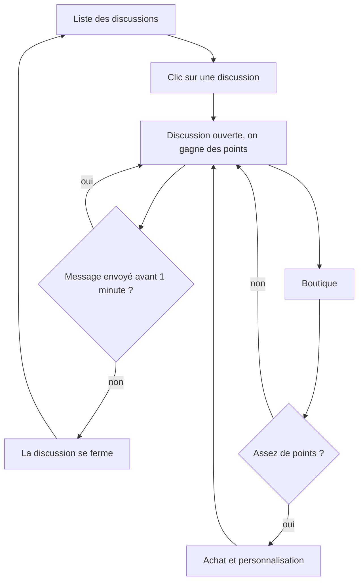

# Conception de Messagerie Custom

Projet fil rouge du cours 8WEB101 à l'UQAC, automne 2026, réalisé par Ellande Cros et Émeric Aubert. On a suivi la démarche vue en cours : d'abord l'analyse des besoins, puis l'architecture du site, puis le visuel.

## Analyse des besoins

### Objectifs

L'objectif principal est d'avoir une messagerie où on envoie et reçoit des messages en temps réel, en privé ou dans un salon de groupe. Notre fonctionnalité en plus fait aussi partie des objectifs principaux : on gagne des points quand une discussion privée est ouverte.

Les objectifs secondaires viennent après. On veut pouvoir dépenser ses points dans une boutique pour personnaliser une discussion, et voir un classement des contacts avec qui on discute le plus.

### Public cible

Le site vise surtout des étudiants de 18 à 30 ans qui discutent tous les jours avec leurs amis ou leur équipe de projet, souvent sur téléphone.

Notre persona s'appelle Léa. Elle a 21 ans et elle est étudiante. Elle écrit à ses amis entre deux cours ou dans le bus. Elle trouve que toutes les messageries se ressemblent. Elle regarde des lives sur Twitch et elle aime y accumuler des points de chaîne, c'est de là que vient notre idée.

### Contraintes

Le site est hébergé sur GitHub Pages, qui n'accepte pas de code serveur. Les comptes et les messages sont donc gérés par Supabase, avec l'offre gratuite qui limite le nombre d'e-mails envoyés. Le site doit marcher sur ordinateur et sur téléphone. On doit le rendre le 29 octobre 2026 à 23 h 59.

Pour les données personnelles, on garde seulement l'adresse e-mail, le nom d'utilisateur et les messages, et chacun peut supprimer son compte. Pour l'accessibilité, on utilise du HTML sémantique et des étiquettes sur tous les champs de formulaire.

## Architecture

### Arborescence

On arrive sur la page de connexion. Une fois connecté, on a accès à quatre pages. Les discussions sont la page principale, avec deux fenêtres qui s'ouvrent par-dessus.

```
Connexion / Inscription (index.html)
├── Discussions (conversation.html)
│   ├── Nouvelle discussion (fenêtre)
│   └── Boutique (fenêtre)
├── Contacts (contact.html)
├── Classement (classement.html)
└── Paramètres (parametre.html)
```

### Règles des points

Une discussion compte comme active quand elle est ouverte à l'écran. Quand on clique sur une discussion privée, elle s'ouvre à droite et on gagne 1 point toutes les 10 secondes avec ce contact. Si on n'envoie aucun message pendant 1 minute, la discussion se ferme toute seule.

Écrire au clavier remet aussi le chrono à zéro, pour que quelqu'un qui écrit un long message ne soit pas coupé. Le temps passé à écrire donne des points en attente, qui sont ajoutés seulement quand le message est envoyé, avec un maximum de 12 points par message. Un message fait au plus 500 caractères. Ces deux limites empêchent de tricher avec un programme qui taperait à l'infini.

Chaque personne a ses propres points avec chaque contact. Si Lucas participe plus qu'Arthur dans leur discussion, Lucas gagnera plus de points qu'Arthur.

Les points servent à acheter des articles dans la boutique : un fond de discussion, une forme de bulle, un cadre pour la photo de profil, une police ou une couleur. Un achat vaut pour un seul contact et il est visible seulement par la personne qui l'a acheté. On garde deux compteurs. Le solde baisse quand on achète. Les points gagnés ne baissent jamais et servent au classement, comme ça acheter ne fait pas descendre un contact.

### Flux d'utilisation

Ce schéma montre le parcours pour gagner des points puis les dépenser. GitHub le dessine à partir du code ci-dessous.



## Visuel

La couleur principale est une prune (#563a8f) pour les boutons, les liens et nos propres messages. On l'a choisie plus sombre que le violet qu'on avait au départ, qui était le violet par défaut de beaucoup de sites. Tout ce qui concerne les points est en or (#d4a017). Le fond des pages est un blanc cassé chaud (#f5f2ec), un peu comme du papier, et les blocs posés dessus sont blancs. Le texte est presque noir (#24212b) et le rouge (#b42318) est réservé aux erreurs et à la suppression du compte.

Le site utilise une seule police, celle du système (Segoe UI sur Windows, Roboto sur Android, San Francisco sur Apple). Elle est lisible et n'a rien à télécharger, donc les pages s'affichent vite. Les polices plus originales sont réservées aux articles de la boutique.

On a gardé un style sobre. Les coins sont peu arrondis (6 à 10 pixels), les blocs ont une bordure fine plutôt qu'une ombre, et seules les fenêtres (boutique, nouvelle discussion) ont une ombre parce qu'elles passent au-dessus de la page. Les animations se limitent au changement de couleur des boutons et des liens, et elles sont coupées si la personne a demandé moins d'animations dans son système.
