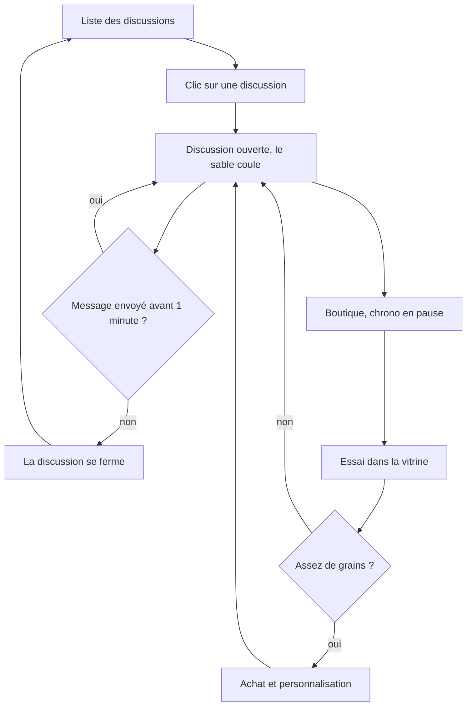

# Conception de TimeChat

Projet fil rouge du cours 8WEB101 à l'UQAC, automne 2026, réalisé par Ellande Cros et Émeric Aubert. On a suivi la démarche vue en cours : d'abord l'analyse des besoins, puis l'architecture du site, puis le visuel.

## Analyse des besoins

### Objectifs

L'objectif principal est d'avoir une messagerie où on envoie et reçoit des messages en temps réel, en privé ou dans un salon de groupe. Notre fonctionnalité en plus fait aussi partie des objectifs principaux : on gagne des grains tant qu'une discussion est ouverte, un peu comme les points de chaîne sur Twitch.

Les objectifs secondaires viennent après. On veut pouvoir dépenser ses grains dans une boutique pour personnaliser une discussion, et voir un classement des discussions où on est le plus actif.

### Public cible

Le site vise surtout des étudiants de 18 à 30 ans qui discutent tous les jours avec leurs amis ou leur équipe de projet, souvent sur téléphone.

Notre persona s'appelle Léa. Elle a 21 ans et elle est étudiante. Elle écrit à ses amis entre deux cours ou dans le bus. Elle trouve que toutes les messageries se ressemblent. Elle regarde des lives sur Twitch et elle aime y accumuler des points de chaîne, c'est de là que vient notre idée.

### Contraintes

Le site est hébergé sur GitHub Pages, qui n'accepte pas de code serveur. Les comptes et les messages sont donc gérés par Supabase, avec l'offre gratuite qui limite le nombre d'e-mails envoyés. Le site doit marcher sur ordinateur et sur téléphone, y compris les téléphones avec une encoche.

Pour les données personnelles, on garde seulement l'adresse e-mail, le nom d'utilisateur, la couleur de l'avatar et les messages, et chacun peut supprimer son compte. Une page explique tout ça (confidentialite.html). Pour l'accessibilité, on utilise du HTML sémantique, des étiquettes sur tous les champs, des zones cliquables d'au moins 44 pixels et un contraste d'au moins 4,5 pour 1 sur le texte.

## Architecture

### Arborescence

On arrive sur la page de connexion. Une fois connecté, le menu mène à trois pages. On ouvre son profil en cliquant sur son nom en haut à droite. Les discussions sont la page principale, avec deux fenêtres qui s'ouvrent par-dessus. La page de confidentialité est accessible depuis le pied de page, même sans compte, et une page 404 s'affiche si une adresse n'existe pas.

```
Connexion / Inscription (index.html)
├── Discussions (conversation.html)
│   ├── Nouvelle discussion (fenêtre)
│   └── Boutique (fenêtre)
├── Contacts (contact.html)
├── Classement (classement.html)
├── Mon profil (parametre.html, par le nom en haut à droite)
├── Confidentialité et mentions légales (confidentialite.html)
└── Page introuvable (404.html)
```

Le JavaScript est découpé par rôle. config.js crée le client Supabase, interface.js contient les petits outils utilisés partout (toasts, messages d'erreur), commun.js gère la session et ce qui est partagé entre les pages connectées. Chaque page a ensuite son fichier. Sur la page des discussions, points.js s'occupe du chrono et des grains, boutique.js de la boutique et effets.js des animations et des sons.

### Règles des grains

Une discussion compte comme active quand elle est ouverte à l'écran. Quand on clique sur une discussion, privée ou de groupe, elle s'ouvre à droite et on gagne 1 grain toutes les 10 secondes dans cette discussion. Si on n'envoie aucun message pendant 1 minute, la discussion se ferme toute seule. Pendant qu'on est dans la boutique le chrono est en pause, pour que la discussion ne se ferme pas au milieu d'un achat, et on ne gagne pas de grains pendant ce temps.

Écrire au clavier remet aussi le chrono à zéro, pour que quelqu'un qui écrit un long message ne soit pas coupé. Le temps passé à écrire donne des grains en attente, qui sont ajoutés seulement quand le message est envoyé, avec un maximum de 12 par message. Un message fait au plus 500 caractères. Ces deux limites empêchent de tricher avec un programme qui taperait à l'infini, et la base vérifie de son côté qu'on ne gagne pas plus d'un grain toutes les 10 secondes.

Chaque personne a ses propres grains dans chaque discussion. Si Lucas participe plus qu'Arthur dans leur discussion, Lucas gagnera plus de grains qu'Arthur.

Dans le code et dans la base on parle encore de « points » (la table points, la fonction crediter_points). Le mot « grains » est arrivé avec le nom TimeChat et on l'utilise seulement dans les textes affichés.

### La boutique

La boutique propose 47 articles rangés en sept catégories : les fonds, les formes de bulles, les cadres des photos, les polices, la couleur de nos bulles, les effets quand on envoie un message et le son quand un message arrive. Chaque article a un petit détail à lui. Le fond Dune voit son sable monter pendant que la minute passe, le fond Ciel du moment change selon l'heure, la bulle Télégramme finit chaque message par STOP, la couleur Humeur dépend du ton du message et la police Machine à écrire fait apparaître les nouveaux messages lettre par lettre.

En haut de la boutique, une vitrine montre une petite discussion avec l'article qu'on essaie avant de l'acheter. Un achat vaut pour une seule discussion et il est visible seulement par la personne qui l'a acheté. On garde deux compteurs. Le solde baisse quand on achète. Les grains gagnés ne baissent jamais et servent au classement, comme ça acheter ne fait pas descendre une discussion dans le classement.

### Flux d'utilisation

Ce schéma montre le parcours pour gagner des grains puis les dépenser. GitHub le dessine à partir du code ci-dessous.



## Visuel

Le site s'appelle TimeChat et son slogan est « La minute qui rapporte ». Le logo montre deux bulles de dialogue tête-bêche qui forment un sablier : en haut les trois points de « en train d'écrire », en bas les grains gagnés. Toute l'ambiance vient de là, avec un côté papier, encre et horlogerie.

Il y a trois couleurs principales. L'encre (#1f2a44) sert aux titres, aux boutons et à nos propres bulles. Le sable (#c8923a) est réservé aux grains et au minuteur, et on ne l'utilise jamais pour du texte sur le fond clair parce que le contraste serait trop faible. Le papier (#f4efe6) est le fond des pages, avec un grain très léger dessiné en SVG pour ne pas avoir un fond tout plat. La brique (#b5442e) est réservée aux erreurs et la sauge (#2f6b4a) aux confirmations.

Les titres sont en Young Serif et le texte en Atkinson Hyperlegible, une police pensée pour la lecture où le l, le I et le 1 ne se confondent pas. Les deux viennent de Google Fonts. Les polices de la boutique sont chargées seulement quand quelqu'un s'en sert.

On a gardé un style sobre. Les coins sont presque droits (4 à 6 pixels), les blocs ont une bordure fine plutôt qu'une ombre, et seules les fenêtres et les notifications ont une ombre parce qu'elles passent au-dessus de la page. Les animations servent toutes à quelque chose : un message qui arrive glisse en place, un « +1 » s'envole quand on gagne un grain, le minuteur bat dans les dernières secondes et le grand sablier de l'accueil se retourne quand il est vide. Elles sont toutes coupées si la personne a demandé moins d'animations dans son système.

Sur téléphone, le menu passe en bas de l'écran pour être sous le pouce, la page des discussions montre soit la liste soit la discussion ouverte, et la boutique prend tout l'écran.
